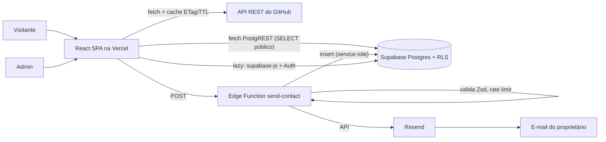

# Arquitetura e fluxo de dados

## Camadas

Pages/Components (visual) → hooks (`useResource`, `useGithubRepos`) → services (`github`, `contact`, `featured`, `admin`) → externos. Zod em `schemas/`.

## Projetos (GitHub)

`services/github.ts`: cache em localStorage (TTL 10 min) + ETag (304 não consome limite), deduplicação de chamadas simultâneas, ordenação, tratamento de 403/429 (usa cache vencido se houver; senão mostra aviso com horário de reset), filtros (sem forks/arquivados/repo de perfil), fallback para descrição/linguagem ausentes.

## Contato

RHF + Zod → Edge Function → revalida → rate limit por e-mail (3/10 min) → insert em `messages` → e-mail via Resend. A mensagem é salva antes do e-mail: se o e-mail falhar, o contato não se perde (`emailSent:false` nos logs/resposta).

## Admin

`/admin/*` é lazy. `AuthProvider` valida sessão e consulta `admins`. `ProtectedRoute`: carregando → spinner; sem sessão → `/admin/login`; sessão sem permissão → "Acesso negado". Segurança real é o RLS; a guarda de rota é só UX.

## RLS

| Tabela            | anon   | authenticated (não admin) | admin                       |
| ----------------- | ------ | ------------------------- | --------------------------- |
| messages          | nada   | nada                      | select/update/delete        |
| featured_projects | select | select                    | select/insert/update/delete |
| admins            | nada   | select da própria linha   | idem                        |
